<!-- Header -->
<p align="center">
  <picture>
    <source media="(prefers-color-scheme: dark)" srcset="assets/banner-dark.svg"/>
    <source media="(prefers-color-scheme: light)" srcset="assets/banner-light.svg"/>
    
  </picture>
</p>

<p align="center">
  <a href="https://git.io/typing-svg">
    
  </a>
</p>

<p align="center">
  <a href="mailto:omkarjadhav8124@gmail.com"></a>
  
  
</p>

---

## 👨‍💻 About Me

I build full-stack products with AI inside them, from the database and the API to the interface, and I
measure them before I call them done: held-out test sets, cross-validation, calibration and end-to-end tests.

```yaml
name: Omkar Jayvant Jadhav
role: Full-Stack & AI Engineer
education: B.Tech, Computer Science & Business Systems @ KIT College of Engineering, Kolhapur (CGPA 9.1/10)
graduation: 2027
focus: [LLM agents & tool calling, Hybrid RAG, Safety guardrails, Computer vision, Full-stack web apps]
builds_with: [Python, FastAPI, React, PostgreSQL + pgvector, Docker]
```

---

## 🛠️ Tech Stack

<h4 align="center">Languages</h4>
<p align="center">
  
</p>

<h4 align="center">Full-Stack</h4>
<p align="center">
  
</p>

<h4 align="center">AI / ML</h4>
<p align="center">
  
</p>
<p align="center">
  
  
  
  
  
  
  
  
</p>

<h4 align="center">Testing, DevOps & Cloud</h4>
<p align="center">
  
</p>
<p align="center">
  
  
  
  
</p>

---

## 🚀 Featured Projects

<table>
  <tr>
    <td width="50%" valign="top">
      <h3>🏥 <a href="https://github.com/OmkarJayvantJadhav/CareFlow">CareFlow</a></h3>
      <b>Hospital OPD platform with an LLM agent and hybrid RAG</b>
      <p>Multilingual (English, Hindi, Marathi) app for patients, front desk, doctors and admins: booking, check-in, live queues over WebSockets and reminders, plus a chat assistant that books through validated tools and asks before every change.</p>
      <ul>
        <li><b>85.9% Recall@5</b> hybrid retrieval (pgvector + BM25 + re-ranking)</li>
        <li><b>60/60</b> held-out emergencies caught, <b>15/15</b> prompt-injection tests passed</li>
        <li>Wait-time model <b>17.9 min MAE</b> vs 29.4 min baseline</li>
        <li><b>464</b> pytest + <b>44</b> Playwright tests</li>
      </ul>
      <a href="https://careflow-zy87.onrender.com"></a>
      
      
      
      
    </td>
    <td width="50%" valign="top">
      <h3>🔬 <a href="https://github.com/OmkarJayvantJadhav/MedVisionAI">MedVision AI</a></h3>
      <b>Skin-lesion referral check for dermoscopy images</b>
      <p>EfficientNet-B0 fine-tuned on ISIC 2019 (25,331 images, 8 classes) with lesion-grouped splits. Calibrated probabilities, Grad-CAM explanations, and it refuses images it cannot judge. Served on CPU with ONNX Runtime behind a React app.</p>
      <ul>
        <li><b>90.4%</b> of malignant test images flagged, ROC-AUC <b>0.935</b></li>
        <li>Calibration error (ECE) <b>0.026</b> after temperature scaling</li>
        <li>Out-of-distribution check rejects <b>99.6%</b> of non-dermoscopy images</li>
        <li>About <b>30 ms</b> per image on CPU, no TensorFlow at runtime</li>
      </ul>
      <a href="https://medvision-ai-hguo.onrender.com"></a>
      
      
      
      
    </td>
  </tr>
</table>

<table>
  <tr>
    <td width="33%" valign="top">
      <h4>📝 <a href="https://github.com/OmkarJayvantJadhav/omr-evaluator">SCANALYZE</a></h4>
      <b>OMR sheet evaluator</b>
      <p>Teachers create exams and answer keys; students upload their OMR sheet and get their score. OpenCV corrects tilted images and detects filled bubbles.</p>
      
      
      
    </td>
    <td width="33%" valign="top">
      <h4>💬 <a href="https://github.com/OmkarJayvantJadhav/pulse-talk">PulseTalk</a></h4>
      <b>Sentiment analysis platform</b>
      <p>Analyses text and social media posts for sentiment and emotion with pre-trained Hugging Face models served through FastAPI, with a React dashboard.</p>
      
      
      
    </td>
    <td width="33%" valign="top">
      <h4>📚 <a href="https://github.com/OmkarJayvantJadhav/Chat-with-your-Docs">Chat with your Docs</a></h4>
      <b>RAG over your own PDFs</b>
      <p>Upload PDFs and ask questions in plain English; every answer is grounded in the documents and shows the passages it came from.</p>
      
      
      
    </td>
  </tr>
</table>

<p align="center">
  <b>Data engineering & analytics:</b>
  <a href="https://github.com/OmkarJayvantJadhav/breathesense">BreatheSense</a> (automated air-quality ETL for India: OpenAQ → PostgreSQL → Power BI)
  ·
  <a href="https://github.com/OmkarJayvantJadhav/Shop-Trail">ShopTrail</a> (e-commerce funnel analysis on 4.3M GA4 events with BigQuery and Power BI)
</p>

---

<p align="center">
  <i>"First, solve the problem. Then, write the code."</i>
</p>
